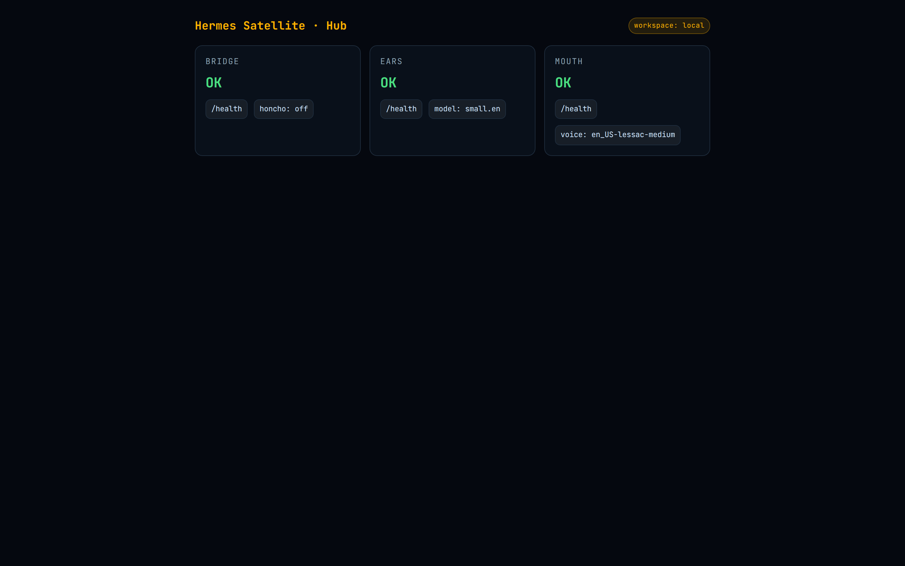

<div align="center">


# satvox

Formerly VoiceSat.

**Jarvis-style wake-word voice pipeline — a hub and Raspberry Pi satellites that hear, think, and speak entirely on your own hardware.**

[](https://github.com/OneByJorah/satvox/releases)
[](https://pypi.org/project/satvox/)
[](https://www.docker.com/)
[](https://www.python.org/downloads/)
[](https://github.com/dscripka/openWakeWord)
[](https://www.raspberrypi.com/)
[](https://opensource.org/licenses/MIT)

</div>



## Why this exists

Smart speakers stop working when the cloud does, and they hear everything you say. satvox splits the job: a cheap Raspberry Pi satellite listens for a wake word and streams audio to a hub that runs STT, an LLM, and TTS locally. Conversation memory is kept in a self-hosted [Honcho](https://github.com/user-attachments/assets/placeholder) instance so every satellite shares the same brain. Add as many satellites as you want; your voice data never leaves your network.

Built for privacy-conscious users who want a voice assistant that works entirely on their own hardware.

## Quick start

The fastest way to run satvox is with Docker Compose. The command below builds the hub images, starts the ears (STT), mouth (TTS), and bridge/dashboard, and makes the dashboard available at `http://localhost:8000`.

```bash
git clone https://github.com/OneByJorah/satvox.git
cd satvox
cp .env.example .env
docker compose up -d --build
```

Verify the hub is healthy:

```bash
curl http://127.0.0.1:8000/health
# {"status":"ok","honcho":false}
```

Open the dashboard:

```bash
# Linux / macOS
open http://localhost:8000

# Windows
start http://localhost:8000
```

To stop everything:

```bash
docker compose down -v
```

### Installer scripts

Linux/macOS/WSL:

```bash
bash install.sh
```

Windows (PowerShell, Docker Desktop required):

```powershell
.\install.ps1
```

## Features

- **Wake-word detection** — openWakeWord-based wake word on Raspberry Pi satellites.
- **Local speech-to-text** — Whisper runs inside the `ears` container, no cloud required.
- **Local text-to-speech** — Piper runs inside the `mouth` container for offline replies.
- **Local LLM bridge** — forwards transcribed speech to any OpenAI-compatible chat endpoint you control.
- **Shared memory** — conversation context is stored in Honcho so all satellites remember the same user.
- **Multi-satellite** — add as many Raspberry Pi satellites as you want.
- **Web dashboard** — one-page status view for the bridge, ears, and mouth services.
- **Privacy-first** — no cloud, no data leaves your network by default.
- **Docker-first** — one command start with Docker Compose.

## Configuration

Copy `.env.example` to `.env` and set the values you need. The hub starts with sensible defaults and only the LLM/Honcho endpoints need real values for full voice conversations.

| Variable | Default | Purpose |
| --- | --- | --- |
| `HUB_BIND_IP` | `127.0.0.1` | IP the hub dashboard/API binds to. |
| `HUB_PORT` | `8000` | Host port for the hub dashboard/API. |
| `WHISPER_MODEL` | `small.en` | Whisper model used by ears. |
| `WHISPER_DEVICE` | `cpu` | Device for Whisper (`cpu` or `cuda`). |
| `WHISPER_COMPUTE_TYPE` | `int8` | Whisper compute type. |
| `PIPER_VOICE` | `en_US-lessac-medium` | Piper voice used by mouth. |
| `HERMES_API_URL` | *(unset)* | OpenAI-compatible chat endpoint. |
| `HERMES_API_KEY` | *(unset)* | API key for the chat endpoint. |
| `HERMES_MODEL` | `hermes-3-llama-3.1-8b` | Model name sent to the chat endpoint. |
| `HONCHO_URL` | *(unset)* | Self-hosted Honcho URL for shared memory. |
| `HONCHO_API_KEY` | *(unset)* | Honcho API key. |
| `HONCHO_WORKSPACE_ID` | `satvox` | Honcho workspace. |
| `HONCHO_USER_ID` | `appuser` | Default user ID in Honcho. |
| `HONCHO_ASSISTANT_ID` | `satvox` | Assistant ID in Honcho. |
| `HONCHO_CONTEXT_TOKENS` | `4000` | Max context tokens fetched from Honcho. |
| `BRIDGE_URL` | *(placeholder)* | URL the satellite sends utterances to. |
| `WAKE_MODEL` | `hey_jarvis` | openWakeWord model on the satellite. |
| `SATELLITE_ID` | `satellite-1` | Unique name for each satellite. |

## Satellite setup

On a Raspberry Pi with a microphone:

```bash
git clone https://github.com/OneByJorah/satvox.git
cd satvox
cp .env.example .env
# edit .env: BRIDGE_URL=http://<your-hub-host>:18000/satellite/utterance
docker compose -f docker-compose.satellite.yml up -d --build
```

See [`SATELLITE_PI_DEPLOY.md`](SATELLITE_PI_DEPLOY.md) for detailed Pi setup.

## Architecture

```mermaid
graph LR
    A[Raspberry Pi Satellite<br/>wake word + audio capture] --|HTTP POST /satellite/utterance| B[satvox Bridge]
    B --|HTTP GET /transcribe| C[Ears<br/>Whisper STT]
    B --|HTTP POST /synthesize| D[Mouth<br/>Piper TTS]
    B -.->|conversation memory| E[(Honcho)]
    B --|HTTP POST /v1/chat/completions| F[Your LLM endpoint]
    D --|audio reply| A
```

- **Satellite** runs `wake.py` with openWakeWord and VAD. When it hears the wake word it records the utterance and sends it to the bridge.
- **Bridge** (`hub/bridge/app.py`) orchestrates STT, LLM, TTS, and memory. It also serves the dashboard.
- **Ears** (`hub/ears/server.py`) runs faster-whisper and exposes `/transcribe`.
- **Mouth** (`hub/mouth/server.py`) runs piper and exposes `/synthesize`.
- **Honcho** is optional; without it the bridge still works and simply keeps no memory.

## API endpoints

The hub exposes:

- `GET /` — redirects to `/dashboard/`.
- `GET /dashboard/` — web status dashboard.
- `GET /health` — bridge health (`{"status":"ok","honcho":bool}`).
- `GET /ears/health` — proxied ears health.
- `GET /mouth/health` — proxied mouth health.
- `POST /satellite/utterance?satellite_id=<id>` — accepts a WAV file and returns a WAV reply.

## Roadmap

- Satellite audio playback in the container without host ALSA passthrough.
- Built-in LLM/TTS model management UI in the dashboard.
- Optional cloud-fallback toggle for edge-only deployments.

## Contributing

Contributions are welcome. [Open an issue](https://github.com/OneByJorah/satvox/issues) to report a bug or request a feature. See [`CONTRIBUTING.md`](CONTRIBUTING.md) and [`CODE_OF_CONDUCT.md`](CODE_OF_CONDUCT.md).

## Security

See [`SECURITY.md`](SECURITY.md). Do not open public issues for sensitive vulnerabilities.

## License

MIT — see [`LICENSE`](LICENSE).
